# DriveED Hub — Driving School Management System
**LPU Cavite | Senior Capstone Project**

DriveED Hub is a multi-tenant web application built for driving schools to manage student admissions, theoretical/practical courses, scheduling, instructor evaluations, payments, and student progress tracking.

---

## Recent Updates & Advisory Fixes (October 2026)

The following changes address feedback from capstone advisory consultations and defense preparations:

### Payment Receipt Viewing (404 Fix) — October 24, 2026
- Fixed an issue where clicking "View Receipt" under Admin Payments & Transactions produced an HTTP 404 error.
- Corrected the route parameter resolution in `ReceiptStorageService` so school slugs resolve from active models and authenticated contexts rather than falling back to an unmapped default route.
- Added a `proof_url` accessor on the `Payment` model that automatically checks both the payment record and linked enrollment request.
- Updated `StorageController` to normalize path separators, whitelist legacy directories (`guest-data/`, `receipts/`, `screenshots/`), and search both `local` and `public` disks.

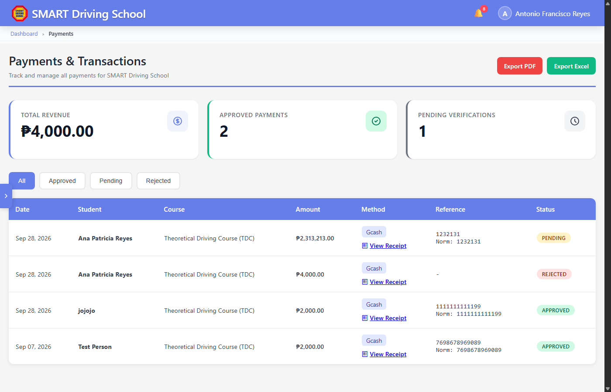
*Admin Payments & Transactions table with working "View Receipt" action.*

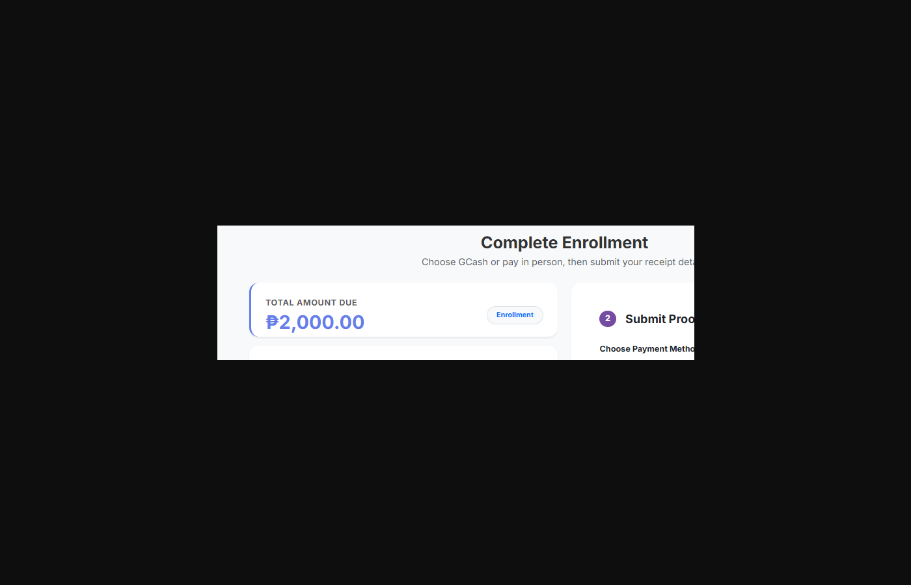
*Inline receipt proof modal streaming verified image directly from secure storage.*

---

### Instructor Session Log Exports (Whole & Per-Session) — October 24, 2026
- Updated `SessionReportController` to accept `session_id` or `booking_id` for exporting individual session logs in addition to date-range exports.
- Added a whole-session export dropdown in the instructor session completions view (`instructor/sessions/index.blade.php`) supporting PDF and Excel (.xlsx).
- Added 1-click PDF and Excel download buttons on each row of the instructor sessions table and mobile cards.
- Added "Export Session (PDF)" and "Export Session (Excel)" action buttons to the single session detail view (`instructor/sessions/show.blade.php`).

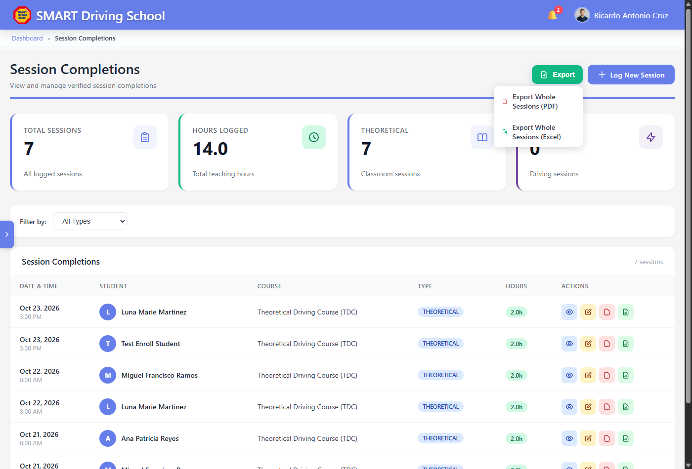
*Instructor session completions view with whole-history export dropdown and per-row PDF/Excel actions.*

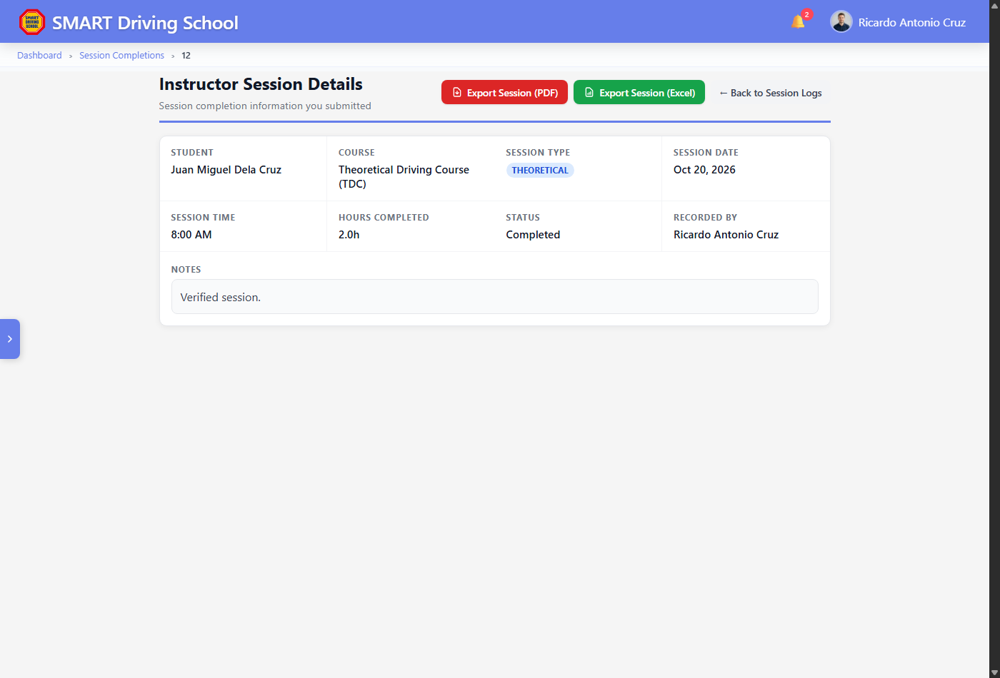
*Individual session log detail page with direct PDF and Excel export buttons.*

---

### Driver's License Expiration Notification & Advisory Hub (Competitive Advantage) — October 24–25, 2026
Unlike traditional driving schools that lose touch with learners after course graduation, DriveED Hub features a comprehensive **Driver's License Expiration Notification & Advisory System** that gives the driving school a continuous competitive edge ("+"):
- **Proactive Multi-Channel Alerts:** Automated daily scans (08:00 AM) detect driver's licenses expiring within 60, 30, and 7 days, as well as expired credentials, automatically dispatching in-app notification badges and responsive advisory emails (`LicenseExpirationReminderMail`).
- **Official LTO LTMS 4-Step Renewal Checklist:** Seamlessly integrated into student and instructor dashboards with direct links to `portal.lto.gov.ph`, online CDE (Comprehensive Driver's Education) exam requirements, and accredited clinic guidelines.
- **Driving School Retention & Refresher Perks:** Recommends refresher driving sessions and vehicle/motorcycle DL code upgrades (A/A1, B/B1/B2) for students renewing licenses.
- **Instructor Legal Compliance:** Real-time instructor dashboard alerts preventing instructors from teaching behind the wheel with expired credentials.
- **Admin License Tracker & 1-Click Reminders:** Dedicated monitoring widget on the Admin Dashboard with expiring/expired counters, quick filtering in User Management, and 1-click on-demand reminder dispatching with cooldown overrides.
- **Strict Anti-Slop UI Standards:** Modern UI designed with vector icons, contextual Philippine placeholders, consistent elevation tokens, and zero AI filler slop.

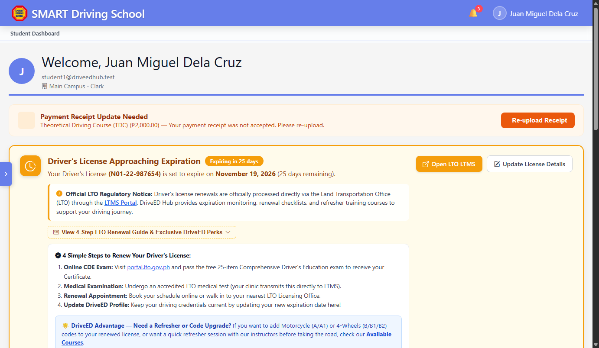
*Student Dashboard showing remaining days alert, official LTO notice, and expanded 4-step renewal checklist.*

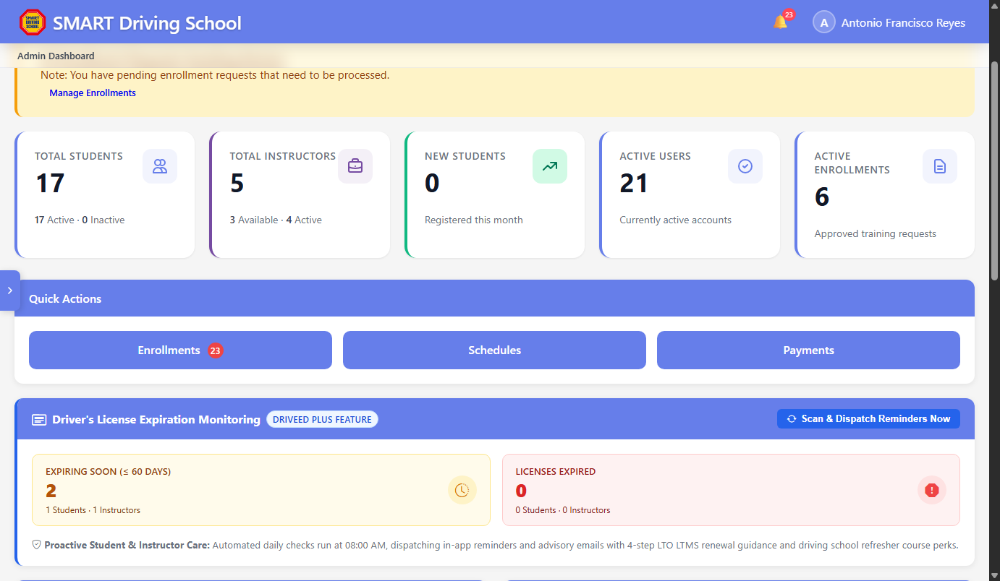
*Admin Dashboard featuring the Driver's License Expiration Monitoring widget and on-demand reminder scan action.*

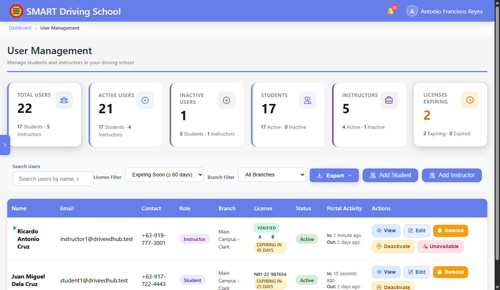
*User Management filtered by expiring licenses with instant "Remind" action buttons.*

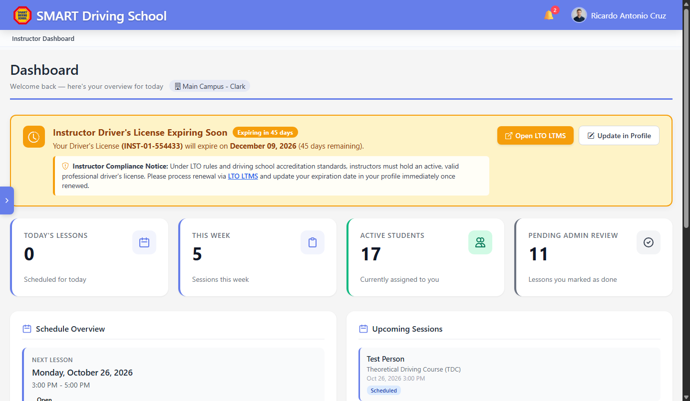
*Instructor Dashboard with legal compliance notice for expiring professional credentials.*

---

### Phase Progression & Certificate Claim Notices — October 22, 2026
- Removed the standalone Phase Progression page. Progression from TDC to PDC is now handled directly through the student dashboard modal and reviewed under Admin Enrollment Requests.
- Added a "Send pickup notice" button in Admin Student Training list so admins can notify students when their certificate of completion is ready.
- Added persistent claim stub notices to the student dashboard.

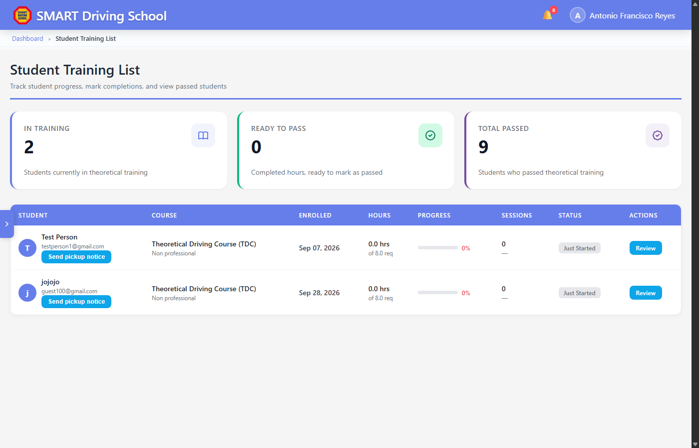
*Admin Student Training management view with "Send Claim Notice" action.*

---

### Schedules & Session Management — October 20–22, 2026
- Added session export capabilities for administrators and students across scheduled slots and attendance records.
- Standardized UI contrast, removed gradient artifacts, and ensured responsive layout across desktop and mobile browsers.

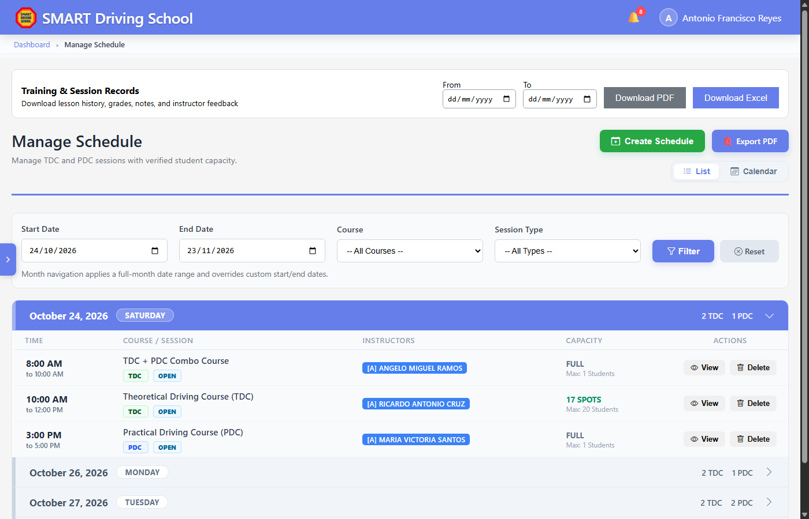
*Admin schedules session view with PDF/Excel reporting controls.*

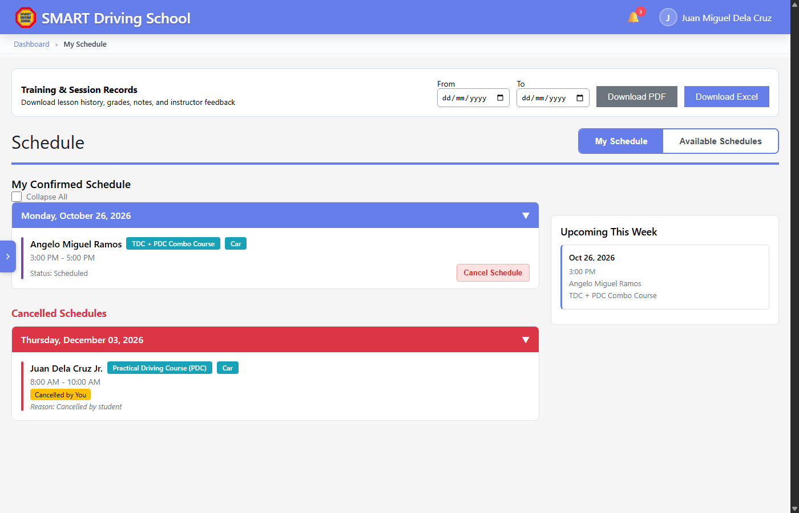
*Student schedule portal with session history and export functionality.*

---

### In-Place Pop-up Modals for Enrollment License & Receipt Re-upload — October 24, 2026
- Converted license and payment receipt re-uploads from multi-page redirects into streamlined in-place pop-up modals.
- Re-uploading a rejected driver's license can now be completed directly from the Guest Enrollment Requests table, Student Course Details, Student Dashboard, or Student Profile without navigating to separate pages.
- Submitting or re-uploading a payment receipt can be performed directly on the Guest Enrollment Requests page, Guest Dashboard, Student Course Details, or Courses Catalog via modal dialogs with instant GCash number copying, QR code scanning, and 13-digit reference number validation.
- Initial enrollment submission seamlessly keeps the user on their active dashboard with the receipt upload modal automatically popped open, completing the full enrollment workflow on a single page.

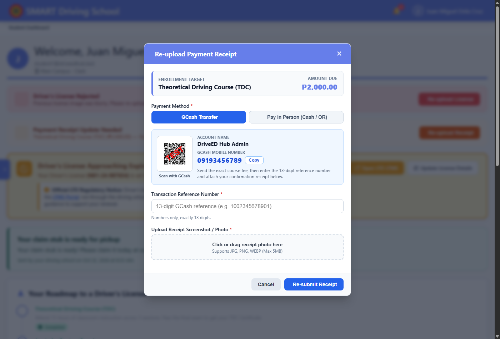
*In-place payment receipt submission pop-up modal with GCash QR preview, account copy tool, and live validation.*

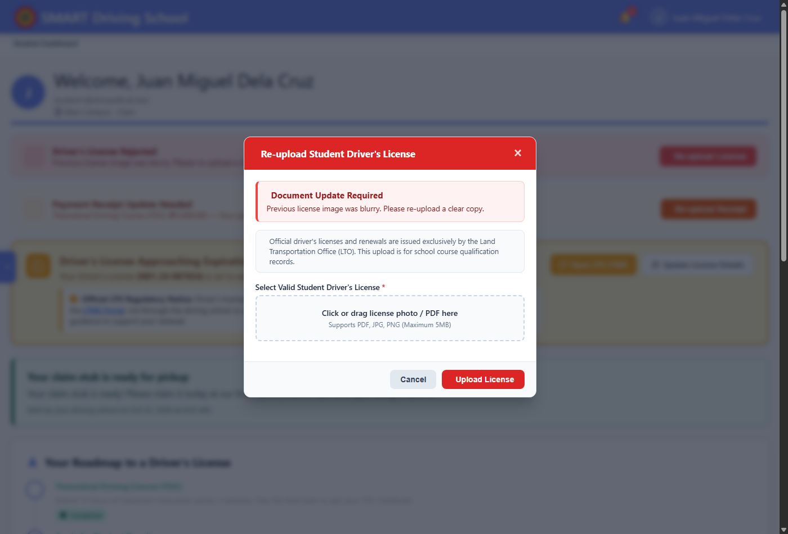
*In-place driver's license re-upload pop-up modal with LTO regulatory notice and direct file dropzone.*

---

### School Admin Authentication & Resilient Dashboard Access — October 26, 2026
- Resolved false-positive session loop terminations caused by unhandled redirections to undefined routes during admin authentication.
- Added explicit route aliasing (`schools.admin.login` mapped to `schools.login`) ensuring multi-tenant consistency.
- Fortified the School Admin dashboard (`AdminController@dashboard`) with isolated defensive query fallbacks for student/instructor counts, growth indicators, trends, revenues, and license stats so non-critical metric failures never block administrators from accessing their dashboard.
- Prevented unintended session invalidation for administrative guards across school context middleware.

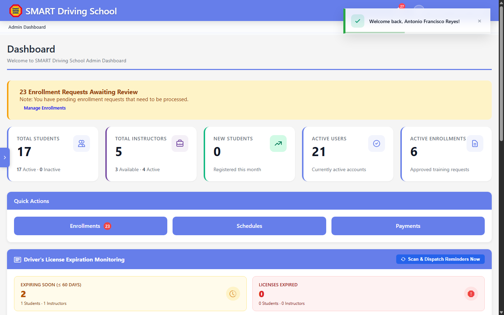
*School Admin dashboard rendering successfully with zero errors following authentication.*

---

### Cross-Module Health Audit & Null-Safe Date Formatting — October 26, 2026
- Conducted full regression scan across 49 views and endpoints across School Admin, Branch Secretary, Instructor, Student, Guest, and System Admin roles.
- Fixed a null pointer exception (`Call to a member function format() on null`) in `school/admin/progress.blade.php` and `school/instructor/reports.blade.php` by implementing null-safe date formatting (`?->format()`) for booking and lesson records without scheduled timestamps.
- Verified 100% pass rate (HTTP 200 OK) across all core module routes and dashboards.

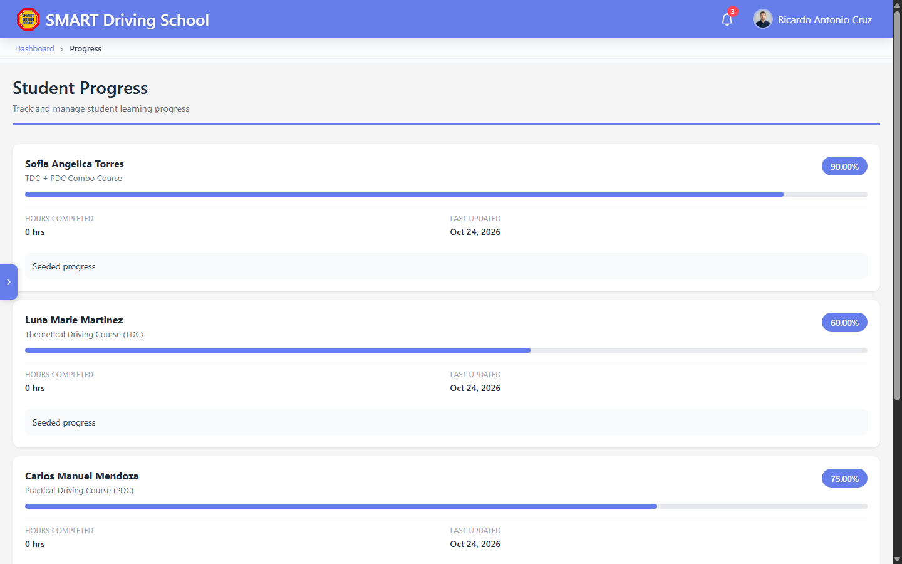
*Instructor Student Progress portal rendering successfully with responsive student status metrics, course tracking, and recent session history.*

---

### Multi-Course Progression & Completed Course Re-Enrollment — October 26, 2026
- **Unblocked Re-Enrollments:** Resolved an issue where students who completed a driving course were blocked from enrolling in new courses or re-enrolling in completed courses.
- **Migration `2026_10_26_000001_drop_unique_student_course_enrollment_index`:** Dropped the unconditional unique index on `enrollment_requests` (`student_id`, `course_id`), permitting multiple historical completions over time.
- **Auto-Unlock Upon Completion:** Updated `Course::complete()` and enrollment workflows to ensure database transactions commit, student records unlock (`is_course_locked = false`, `canEnrollInNewCourse() = true`), and role promotion logic remains consistent.
- **Visual Completion & Re-Enrollment Badge:** Added a green `"✓ Course Previously Completed"` badge and an enabled `"Enroll Again"` button on course catalog and detail views.

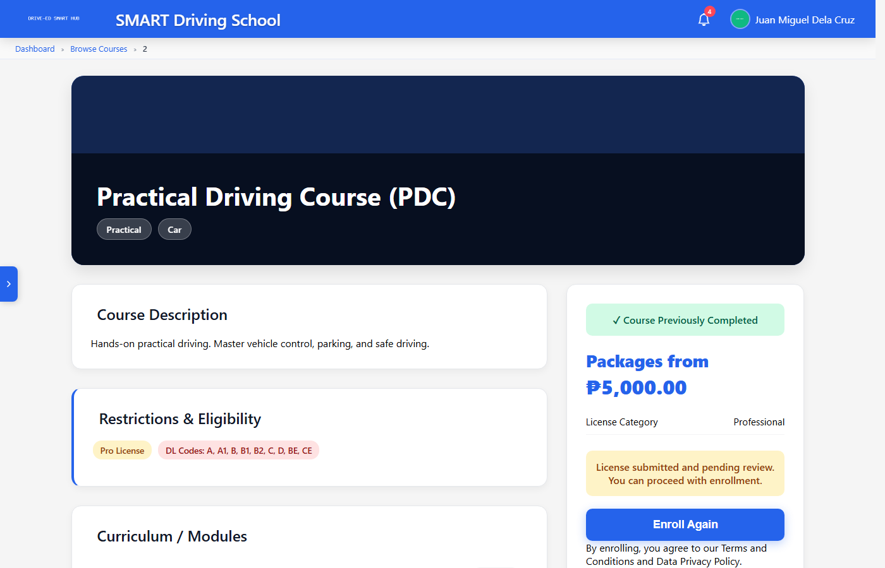
*Course details view displaying completed status badge and active "Enroll Again" action.*

---

### Dynamic Media Handling & School Branding Management — October 26, 2026
- **End-to-End Media Persistence:** Eliminated hardcoded image assets across the platform, replacing them with dynamic file uploads, public disk storage (`storage/app/public/`), automatic cleanup of replaced files, and removal toggles.
- **User Avatars:** Integrated direct avatar upload and live preview across Student, Guest, Instructor, and School Admin profile settings and User Management edit modals.
- **Course Artwork:** Added custom course banner image upload and removal toggles within Admin Course Management.
- **School Branding (Smart Driving School):** Uploaded and persisted the official Smart Driving School logo (`public/images/logo-smart-transparent.png`) via Admin School Settings, dynamically rendering across the top navigation bar, login headers, and public landing pages.

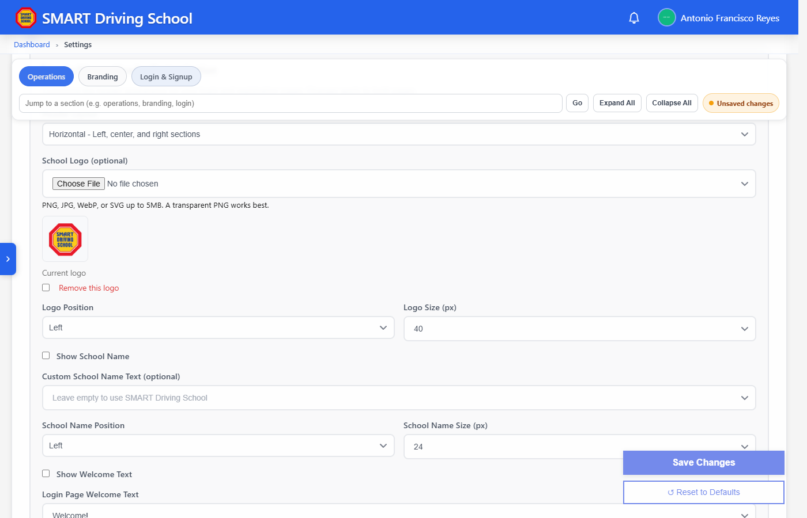
*Admin School Settings with uploaded Smart Driving School logo preview and configuration controls.*

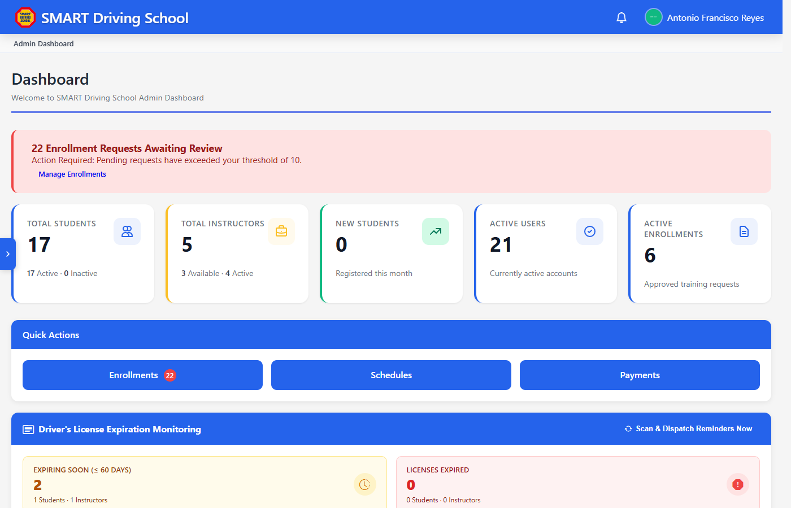
*Admin Dashboard header dynamically rendering the Smart Driving School logo.*

---

### Training & Session Records Export Relocation & Filtering — October 26, 2026
- **Relocated from Schedule to Training Logs:** Moved the "Training & Session Records" export panel from the Schedule section (`schedules.blade.php`) to **Training Logs > Verify Session Completion** (`verify-session-completion.blade.php`).
- **Student & Instructor Filters:** Added dropdown selectors to filter and export records specifically by **Student** and/or **Instructor**, in addition to start/end date ranges.
- **Resolved PDF Export Exceptions:** Fixed DomPDF font caching permissions (`storage/fonts/`), canvas page text font metrics (`DejaVu Sans`), and implemented null-safe attribute formatting in `SessionReportController` and `session-report-pdf.blade.php`.
- **Enriched Export Metadata:** Both PDF and Excel (.xlsx) reports dynamically display the active Student and Instructor filter metadata in report headers.

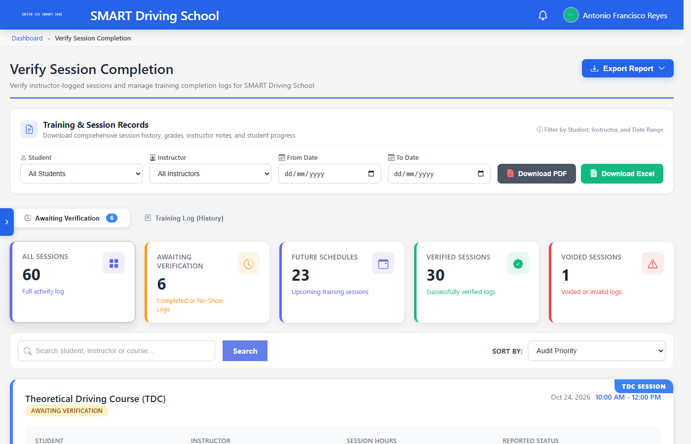
*Verify Session Completion page with Training & Session Records export panel featuring Student and Instructor filters.*

---

### Defense Preparation Documents — October 24, 2026
- Added `docs/CAPSTONE_DEFENSE_MASTER_GUIDE.md`: Presenter guide and 2-laptop walkthrough script (Laptop 1: Student/Guest, Laptop 2: Admin/Instructor).
- Added `docs/SYSTEM_PROCESS_FLOWS_PRESENTATION.md`: Scenario walkthroughs including smooth enrollment, exception handling, and expired license workflows.
- Updated `docs/SYSTEM_DOCUMENTATION.md` to clarify regulatory boundaries between the driving school and the LTO.

---

## Getting Started (Docker)

Run the system locally using Docker Compose:

```bash
# Start containers
docker compose up -d

# Run migrations
docker compose exec app php artisan migrate

# Seed sample data (optional)
docker compose exec app php artisan db:seed --class=DriveEdHubSeeder
```

### Accessing the Portal
- **URL:** `http://localhost:8004/drived-hub`
- **School Slug:** `drived-hub`
- **Admin:** `admin1@driveedhub.test` / `DriveDemo123`
- **Instructor:** `instructor1@driveedhub.test` / `DriveDemo123`
- **Student:** `student1@driveedhub.test` / `DriveDemo123`

---

## Testing & Verification

Automated regression test scripts are located in `tests/`:

```bash
# Verify course re-enrollment & dynamic media persistence
docker compose exec app php tests/verify-enrollment-and-media.php

# Verify session report export & student/instructor filtering
docker compose exec app php tests/verify-session-report-export.php

# Verify session exports & claim notices
docker compose exec app php tests/verify-session-features.php

# Verify receipt serving & path security
docker compose exec app php tests/verify-receipt-serving.php

# Verify license expiration reminders
docker compose exec app php tests/verify-license-expiration-reminders.php

# Verify bundle transitions
docker compose exec app php tests/verify-bundle-transitions.php

# Verify in-place enrollment re-upload modals
docker compose exec app php tests/verify-enrollment-reupload-modals.php

# Verify toast deduplication & schedule validation
node tests/verify-module-toasts.cjs
node tests/verify-schedule-submission.cjs
```

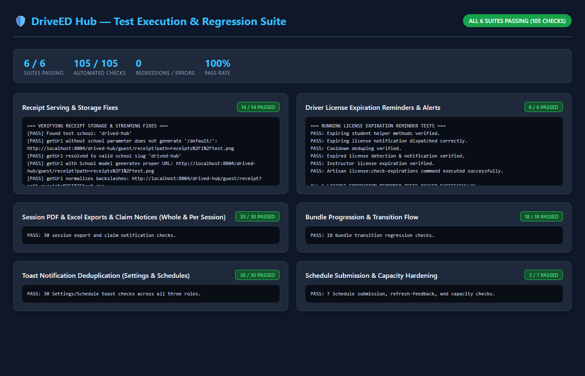
*Terminal output showing 100% pass rate across all automated test suites.*
