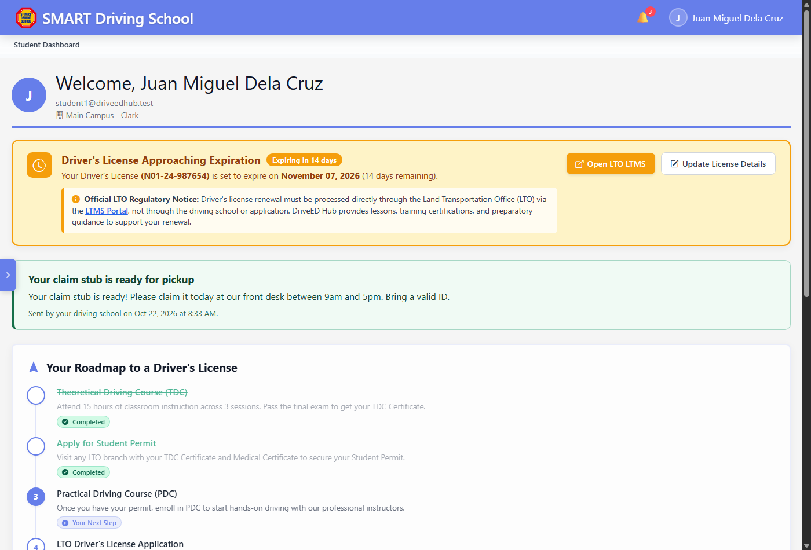

# DriveED Hub — Driving School Management System
**LPU Cavite | Senior Capstone Project**

DriveED Hub is a multi-tenant web application built for driving schools to manage student admissions, theoretical/practical courses, scheduling, instructor evaluations, payments, and student progress tracking.

---

## Recent Updates & Advisory Fixes (October 24, 2026)

The following changes address feedback from capstone advisory consultations and defense preparations:

### Payment Receipt Viewing (404 Fix)
- Fixed an issue where clicking "View Receipt" under Admin Payments & Transactions produced an HTTP 404 error.
- Corrected the route parameter resolution in `ReceiptStorageService` so school slugs resolve from active models and authenticated contexts rather than falling back to an unmapped default route.
- Added a `proof_url` accessor on the `Payment` model that automatically checks both the payment record and linked enrollment request.
- Updated `StorageController` to normalize path separators, whitelist legacy directories (`guest-data/`, `receipts/`, `screenshots/`), and search both `local` and `public` disks.


*Admin Payments & Transactions table with working "View Receipt" action.*


*Inline receipt proof modal streaming verified image directly from secure storage.*

---

### Instructor Session Log Exports (Whole & Per-Session)
- Updated `SessionReportController` to accept `session_id` or `booking_id` for exporting individual session logs in addition to date-range exports.
- Added a whole-session export dropdown in the instructor session completions view (`instructor/sessions/index.blade.php`) supporting PDF and Excel (.xlsx).
- Added 1-click PDF and Excel download buttons on each row of the instructor sessions table and mobile cards.
- Added "Export Session (PDF)" and "Export Session (Excel)" action buttons to the single session detail view (`instructor/sessions/show.blade.php`).


*Instructor session completions view with whole-history export dropdown and per-row PDF/Excel actions.*


*Individual session log detail page with direct PDF and Excel export buttons.*

---

### Driver's License Expiration Reminder
- Added a database migration adding `license_expiration_date` and `license_number` to students and instructors.
- Created `LicenseExpirationReminderService` to check for licenses expiring within 30 days and dispatch notifications with a 7-day cooldown to prevent spam.
- Added an Artisan command (`php artisan license:check-expirations`) scheduled in `routes/console.php`.
- Added an alert banner on the student dashboard that displays remaining days, a link to update license info, and an advisory note that renewals are processed exclusively through the LTO LTMS portal.
- Hardened the `school_route()` helper in `helpers.php` to handle optional argument order differences cleanly.


*Student dashboard displaying license expiration notice and certificate claim reminder.*

---

### Phase Progression & Certificate Claim Notices
- Removed the standalone Phase Progression page. Progression from TDC to PDC is now handled directly through the student dashboard modal and reviewed under Admin Enrollment Requests.
- Added a "Send pickup notice" button in Admin Student Training list so admins can notify students when their certificate of completion is ready.
- Added persistent claim stub notices to the student dashboard.


*Admin Student Training management view with "Send Claim Notice" action.*

---

### Schedules & Session Management
- Added session export capabilities for administrators and students across scheduled slots and attendance records.
- Standardized UI contrast, removed gradient artifacts, and ensured responsive layout across desktop and mobile browsers.


*Admin schedules session view with PDF/Excel reporting controls.*


*Student schedule portal with session history and export functionality.*

---

### In-Place Pop-up Modals for Enrollment License & Receipt Re-upload
- Converted license and payment receipt re-uploads from multi-page redirects into streamlined in-place pop-up modals.
- Re-uploading a rejected driver's license can now be completed directly from the Guest Enrollment Requests table, Student Course Details, Student Dashboard, or Student Profile without navigating to separate pages.
- Submitting or re-uploading a payment receipt can be performed directly on the Guest Enrollment Requests page, Guest Dashboard, Student Course Details, or Courses Catalog via modal dialogs with instant GCash number copying, QR code scanning, and 13-digit reference number validation.
- Initial enrollment submission seamlessly keeps the user on their active dashboard with the receipt upload modal automatically popped open, completing the full enrollment workflow on a single page.


*In-place payment receipt submission pop-up modal with GCash QR preview, account copy tool, and live validation.*


*In-place driver's license re-upload pop-up modal with LTO regulatory notice and direct file dropzone.*

---

### Defense Preparation Documents
- Added `docs/CAPSTONE_DEFENSE_MASTER_GUIDE.md`: Presenter guide and 2-laptop walkthrough script (Laptop 1: Student/Guest, Laptop 2: Admin/Instructor).
- Added `docs/SYSTEM_PROCESS_FLOWS_PRESENTATION.md`: Scenario walkthroughs including smooth enrollment, exception handling, and expired license workflows.
- Updated `docs/SYSTEM_DOCUMENTATION.md` to clarify regulatory boundaries between the driving school and the LTO.

---

## Getting Started (Docker)

Run the system locally using Docker Compose:

```bash
# Start containers
docker compose up -d

# Run migrations
docker compose exec app php artisan migrate

# Seed sample data (optional)
docker compose exec app php artisan db:seed --class=DriveEdHubSeeder
```

### Accessing the Portal
- **URL:** `http://localhost:8004/drived-hub`
- **School Slug:** `drived-hub`
- **Admin:** `admin1@driveedhub.test` / `DriveDemo123`
- **Instructor:** `instructor1@driveedhub.test` / `DriveDemo123`
- **Student:** `student1@driveedhub.test` / `DriveDemo123`

---

## Testing & Verification

Automated regression test scripts are located in `tests/`:

```bash
# Verify session exports & claim notices
docker compose exec app php tests/verify-session-features.php

# Verify receipt serving & path security
docker compose exec app php tests/verify-receipt-serving.php

# Verify license expiration reminders
docker compose exec app php tests/verify-license-expiration-reminders.php

# Verify bundle transitions
docker compose exec app php tests/verify-bundle-transitions.php

# Verify in-place enrollment re-upload modals
docker compose exec app php tests/verify-enrollment-reupload-modals.php

# Verify toast deduplication & schedule validation
node tests/verify-module-toasts.cjs
node tests/verify-schedule-submission.cjs
```


*Terminal output showing 100% pass rate across all automated test suites.*
