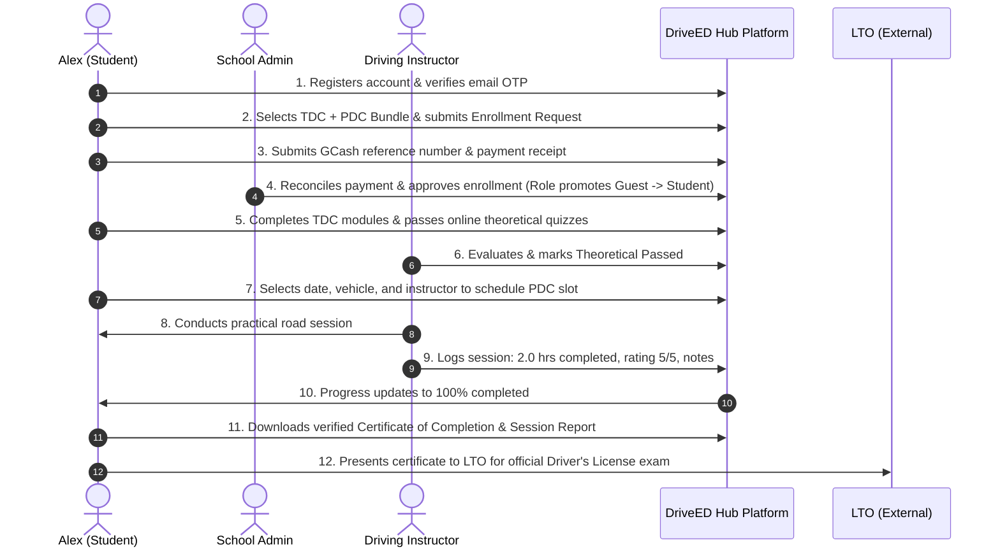
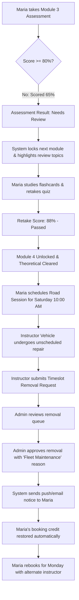
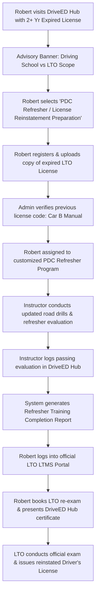
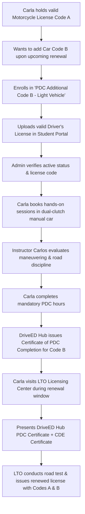

# DriveED Hub — System Process & Flow Presentation Guide
**Audience:** Capstone Defense Panel, Driving School Stakeholders, and Project Presenters  
**Version:** 2.0 (Post-Audit Defense Edition)  
**Core System Scope Rule:** The application and driving school manage driver training (TDC/PDC), progress tracking, scheduling, and completion certifications. The actual issuance and renewal of driver's licenses are handled exclusively by the Land Transportation Office (LTO).

---

## Executive Overview of User Roles & Interaction Matrix

| User Role | Core Responsibility in the Flow | Primary Endpoints |
|---|---|---|
| **Guest / Learner** | Browses offerings, registers, verifies email OTP, submits course enrollment requests. | `/{school}`, `/{school}/register`, `/{school}/guest/dashboard` |
| **Enrolled Student** | Consumes TDC curriculum, takes module assessments, schedules PDC road slots, tracks hours. | `/{school}/student/courses`, `/{school}/student/schedule`, `/{school}/student/my-progress` |
| **Instructor** | Manages daily timetable, logs practical driving hours, grades road competencies, verifies TDC. | `/{school}/instructor/dashboard`, `/{school}/instructor/schedule`, `/{school}/instructor/sessions` |
| **School Admin** | Verifies payments (GCash/Cash), approves enrollments, manages fleet/instructors, audits logs. | `/{school}/admin/dashboard`, `/{school}/admin/payments`, `/{school}/admin/schedules` |

---

## Scenario 1: A Smooth and Successful Process
### Persona: "Alex", a beginner enrolling in a combined TDC + PDC Driver Education Bundle.

### Detailed Step-by-Step Walkthrough:
1. **Public Discovery & Onboarding**:
   - Alex opens the branded school portal (`/{school}`).
   - Clicks **Register** (`/{school}/register`), inputs personal details (name, email, phone, address, branch).
   - Reads and accepts the **Data Privacy Notice** and **Terms & Conditions**.
   - Receives a 6-digit email OTP and enters it on `/{school}/verify-email` to activate the account.
2. **Course Selection & Enrollment**:
   - Accesses the Guest Dashboard (`/{school}/guest/dashboard`).
   - Browses available course packages under `/{school}/guest/courses`.
   - Chooses **TDC + PDC Light Vehicle (Car) Package** and clicks **Enroll Now**.
3. **Payment Submission**:
   - Selects **GCash Payment** on `/{school}/guest/payment-select`.
   - Views the school's official QR code and account number, sends payment, and enters the GCash Reference Number.
   - Status updates to `Payment: Pending Verification` / `Enrollment: Pending Approval`.
4. **Admin Approval & Role Elevation**:
   - School Admin logs into `/{school}/admin` and checks `payments`.
   - Verifies the reference code against the bank/wallet ledger and clicks **Mark as Paid**.
   - Admin approves the enrollment under `enrollment-requests`.
   - The platform automatically elevates Alex from `Guest` to active `Student` and sends an email confirmation.
5. **Phase 1: Theoretical Driving Course (TDC)**:
   - Alex logs into `/{school}/student` and navigates to **My Courses**.
   - Reviews modular lessons sequentially (Traffic Signs, Road Etiquette, Defensive Driving).
   - Takes and passes the integrated multiple-choice assessments.
   - Under `/{school}/instructor/theoretical`, the assigned instructor reviews assessment results and clicks **Mark Theoretical Passed**.
6. **Phase 2: Practical Driving Course (PDC) Scheduling**:
   - Alex opens the live visual calendar on `/{school}/student/schedule`.
   - Selects an open timeslot with Instructor "Carlos" and light vehicle "Toyota Vios (Manual)".
   - Clicks **Schedule Lesson**. The slot immediately locks to prevent overbooking.
7. **Session Execution & Instructor Verification**:
   - Alex and Instructor Carlos conduct the hands-on session.
   - At the conclusion, Instructor Carlos opens `/{school}/instructor/sessions/create`.
   - Logs: `Hours Completed: 2.0`, `Rating: 5/5`, `Competencies: Parallel Parking, Highway Merging`, and notes: *"Excellent vehicle control and mirror check awareness."*
8. **Final Clearance & Export**:
   - Alex's student dashboard reaches 100% hours requirement.
   - Alex downloads the official **PDF Session Completion Report** with timestamped instructor verification.
   - Alex proceeds to the official LTO Licensing Center to take the statutory LTO examination.

---

## Scenario 2: Special Considerations and Exceptions Workflow
### Persona: "Maria", an existing student encountering schedule conflicts and an assessment retry.

### Detailed Step-by-Step Walkthrough:
1. **Exception 1 — Assessment Retake & Progression Lock**:
   - **What happens:** Maria takes the Module 3 Road Rules assessment and scores 65% (passing is 80%).
   - **User Experience:** The system does not advance to Module 4. It renders a clean status banner: *"Score: 65% — Passing threshold is 80%. Review the module lessons and retake when ready."*
   - **Resolution:** Maria re-reads Lesson 2 and Lesson 3. She clicks **Retake Assessment**.
   - She scores 88%. The system logs the passing attempt, unlocks Module 4, and notifies the instructor that Maria is eligible for TDC clearance.
2. **Exception 2 — Instructor/Fleet Emergency & Timeslot Removal**:
   - **What happens:** On Friday afternoon, Instructor Carlos's vehicle suffers a flat tire and alternator issue.
   - **Instructor Action:** Carlos opens `/{school}/instructor/schedule-new`, locates the Saturday 10:00 AM slot, and clicks **Request Removal**.
   - Carlos enters reason: *"Emergency vehicle maintenance needed on Unit #3."*
   - **Admin Action:** School Admin opens `/{school}/admin/removal-requests`. The admin clicks **Approve Removal**.
   - **Student Action:** Maria receives an automated notice: *"Your scheduled session on Saturday 10:00 AM has been rescheduled due to fleet maintenance."*
   - Maria's available session hours balance is fully restored with zero penalty. Maria visits `/{school}/student/schedule` and selects an alternate open slot with Instructor Elena on Monday.
3. **Exception 3 — Payment Reference Discrepancy**:
   - **What happens:** A student enters an invalid GCash reference code (e.g., 8 digits instead of standard 13 digits).
   - **Admin Action:** In `/{school}/admin/payments`, the admin clicks **Flag Discrepancy** with note: *"Reference not found in school wallet."*
   - **Student Action:** The student dashboard displays a highlighted banner prompting the student to update the reference code or present physical cash at the school cashier counter.

---

## Scenario 3: Expired Driver's License Scenario
### Persona: "Robert", whose Non-Professional Driver's License has been expired for over 2 years.

> [!IMPORTANT]
> **Legal Authority Clarification for Panel:**  
> Under Philippine LTO Administrative Orders, a driver whose license has expired for **more than two (2) years** must retake both the Theoretical Examination and Practical Driving Examination at an LTO Licensing Center. Driving schools **do not** and **cannot** renew the license; they provide the refresher education and certified practical training mandated to qualify for the LTO re-examination.

### Detailed Step-by-Step Walkthrough:
1. **Initial Inquiry & Legal Scope Advisory**:
   - Robert arrives at `/{school}` seeking to address his expired driver's license.
   - The platform prominently surfaces the system scope:
     > *"Notice on License Renewal: Actual license issuance and renewal are statutory functions performed solely by the Land Transportation Office (LTO). DriveED Hub provides the accredited refresher lessons and practical evaluations required to prepare for LTO re-licensing."*
2. **Course Enrollment & Prior License Submission**:
   - Robert selects **PDC Refresher & Practical Evaluation Course**.
   - During registration/profile setup, Robert checks **Previous License Holder** and enters his previous LTO License Number.
   - Uploads a photo of his expired physical driver's license card via `/{school}/student/upload-license`.
3. **School Admin Assessment**:
   - Admin reviews Robert's uploaded document.
   - Admin notes: *"Previous Non-Pro License (Expired 28 months). Enrolled for 8-hour Practical Refresher with vehicle code B."*
   - Admin confirms enrollment.
4. **Refresher Practical Sessions**:
   - Robert books road refresher slots with Instructor Carlos.
   - Instructor Carlos conducts targeted training on:
     - New traffic legislation (Anti-Distracted Driving Act, Child Safety in Motor Vehicles Act).
     - Strict parallel parking and three-point turn drills.
     - Defensive road assessment.
   - Carlos logs session completions on `/{school}/instructor/sessions/create`.
5. **Certification & Directing to LTO**:
   - Once all 8 refresher hours are completed and rated passing, the system issues an official **Refresher Course Completion Record (PDF)**.
   - The system displays the **LTO Re-licensing Checklist**:
     1. Create/log into official account on LTO LTMS (`portal.lto.gov.ph`).
     2. Obtain accredited medical certificate from an LTO-certified clinic.
     3. Bring printed DriveED Hub Refresher Certificate and expired license card to the nearest LTO District Office / Licensing Center.
     4. Take and pass the official LTO computerized theoretical and practical driving test to receive the renewed driver's license.

---

## Scenario 4: Driver's License that Needs to be Renewed (Pre-Renewal / Additional Restriction Code)
### Persona: "Carla", who holds a valid Motorcycle License (Code A) and wants to add Light Vehicle (Code B) before her upcoming renewal.

> [!NOTE]
> **Key Distinction for Defense Panel:**  
> - **Routine 5-Year / 10-Year Renewal (Same Vehicle Code)**: Processed 100% directly through LTO LTMS via the online Comprehensive Driver's Education (CDE) quiz and physical LTO medical clinic.
> - **Renewal with Additional Restriction Code / Vehicle Category**: Requires taking an accredited Practical Driving Course (PDC) for the new vehicle type at an accredited driving school. This is where DriveED Hub facilitates the process.

### Detailed Step-by-Step Walkthrough:
1. **Inquiry & Route Selection**:
   - Carla's license is due for renewal in 2 months. She currently only has Motorcycle (Code A) authorization and wants to upgrade to 4-wheel vehicles (Code B).
   - If a user asks for pure renewal with no code changes, DriveED Hub clearly directs them to the LTO LTMS website.
   - For Carla's code addition, she selects **Practical Driving Course (PDC) — Code B (Sedan/SUV)**.
2. **Uploading Existing License**:
   - In her student portal (`/{school}/student`), Carla uploads her valid LTO License.
   - The system validates that her license is not currently suspended or revoked.
3. **Targeted PDC Road Scheduling**:
   - Carla bypasses TDC (since she has already completed theoretical certification for her existing license).
   - She immediately accesses `/{school}/student/schedule` to schedule her mandatory 8 hours of hands-on car driving sessions.
4. **Session Logging & Competency Verification**:
   - Sessions are executed over 4 days (2 hours per session).
   - Instructor evaluates vehicle dimensions management, lane discipline, parking maneuvers, and blind-spot checking.
   - Session completions are logged and visible in real time on Carla's dashboard (`/{school}/student/my-progress`).
5. **Certification & Submission to LTO**:
   - DriveED Hub generates the **Official PDC Certificate of Completion** specifically marked for **Vehicle Code B**.
   - The system presents Carla with her final LTO submission guide:
     1. Complete LTO CDE (Comprehensive Driver's Education) online exam on the LTMS portal.
     2. Undergo medical examination at an accredited LTO clinic.
     3. Present the DriveED Hub PDC Certificate for Code B at the LTO Licensing Center.
     4. Take the LTO practical driving exam for 4-wheelers to receive her renewed driver's license with updated codes: **A, B**.

---

## Comparative Scenario Matrix for Presentation Quick Reference

| Feature / Step | Scenario 1: Standard Student | Scenario 2: Exceptions / Reschedule | Scenario 3: 2+ Yr Expired License | Scenario 4: Additional Code (Renewal) |
|---|---|---|---|---|
| **User Starting Point** | New beginner (No permit) | Active student with issue | Expired license holder | Existing valid license holder |
| **TDC Required?** | Yes (15 hrs curriculum) | Yes (Retakes failed quiz) | Refresher review | Exempted (Holds valid license) |
| **PDC Required?** | Yes (Full standard course) | Yes (Rescheduled seamlessly) | Yes (Targeted refresher) | Yes (Code-specific practical) |
| **Document Uploaded** | Valid ID & PSA/Birth Cert | Valid ID | Expired LTO License | Active LTO License |
| **System Output** | Full TDC & PDC Certificate | Restored booking / Re-graded | Refresher Completion Certificate | PDC Code Addition Certificate |
| **Final Legal Action** | Applies at LTO for Student Permit / Non-Pro License | Continues standard curriculum | Re-examination at LTO District Office | LTO Renewal Counter with Code Addition |
| **LTO Boundary** | Driving school trains; LTO tests & issues | Driving school manages schedule exceptions | LTO re-tests; Driving school prepares | LTO amends card; Driving school certifies code |
