# Before and after review

Before images are from the supplied Word report. After images are from the local app. Click a comparison to inspect it. The role-header finding had no before screenshot in the report.

## 1. Pending email spacing and collapse

After: a temporary example invitation demonstrates recipient spacing. It was removed without sending email.

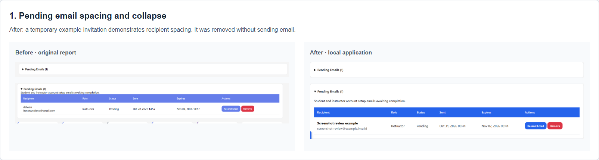

## 2. Collapsible schedule panels

Today’s Lessons, Upcoming This Week, and Cancelled Schedules can each be expanded.

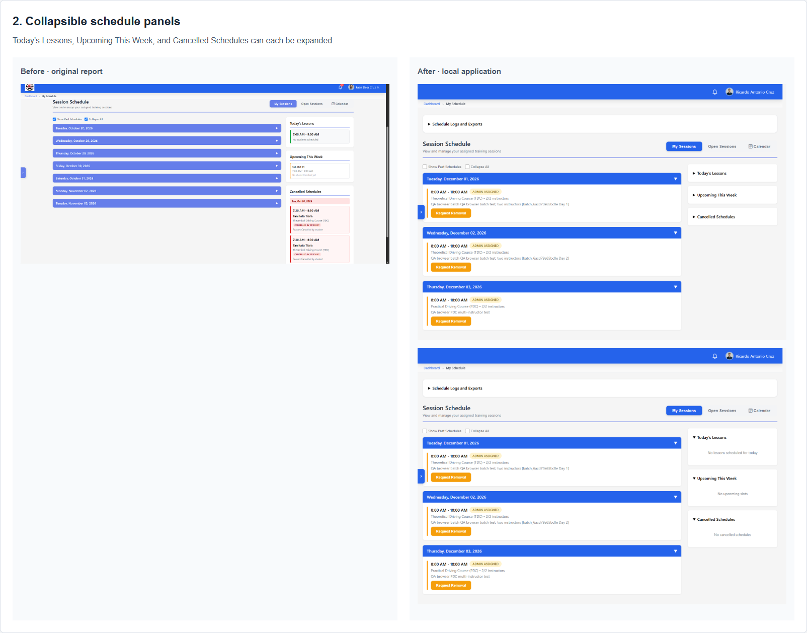

## 3. Instructor calendar modal closes correctly

Open and closed states. Browser verification confirms Close sends no network request.

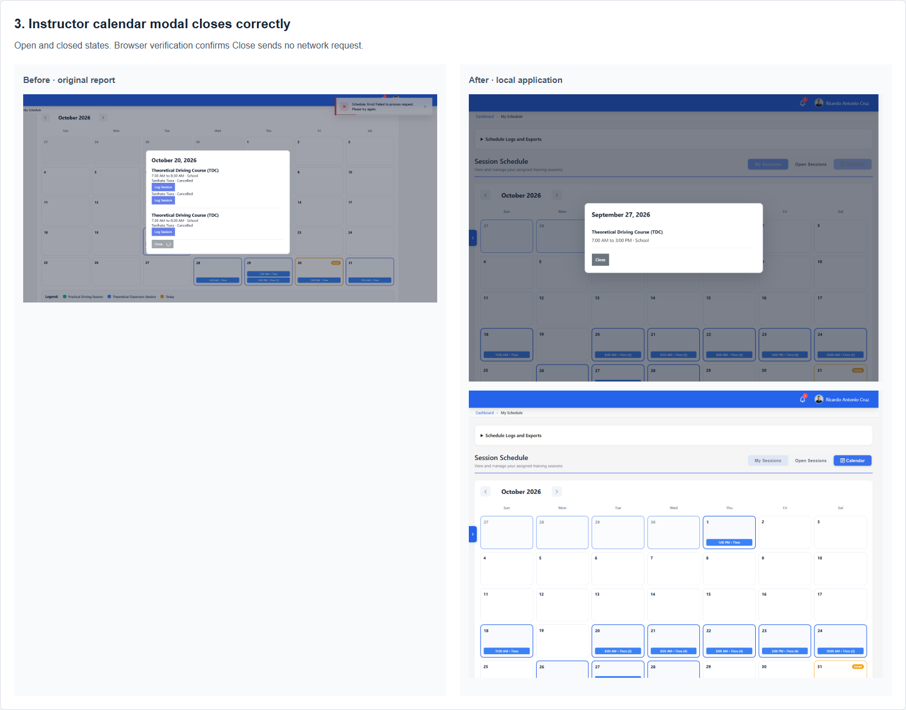

## 4. Student calendar modal closes correctly

Open and closed states. Browser verification confirms Close sends no network request.

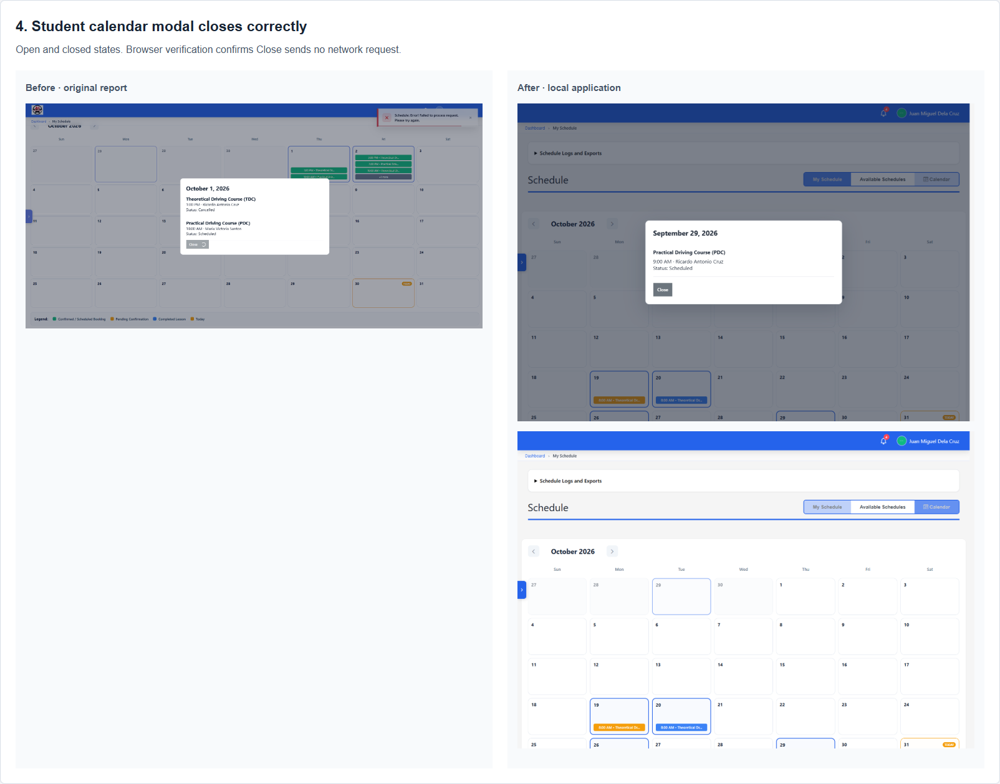

## 5. Calendar fits the page

After: desktop and 390px mobile layouts.

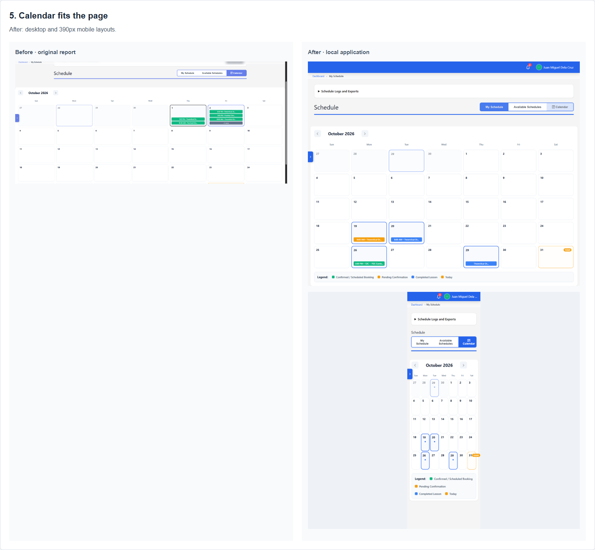

## 6. Instructor calendar modal styling

After: a bounded dialog with backdrop, border, spacing, readable headings, and scrolling.

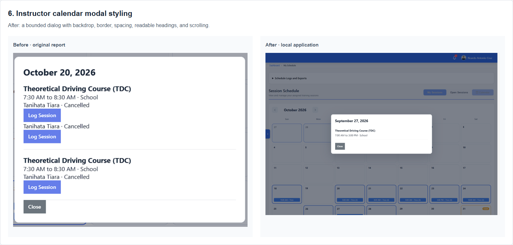

## 7. Collapsible schedule exports

After: collapsed and expanded export controls.

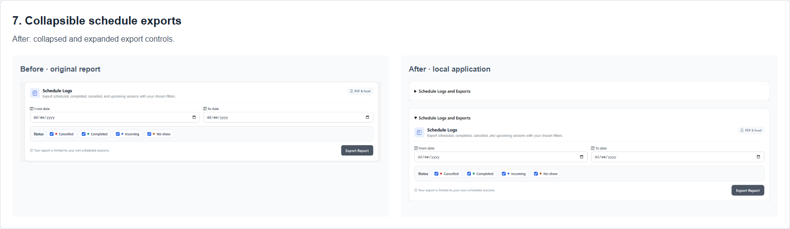

## 8. Separate role header colors

The report states this finding in text but supplies no before screenshot. The new settings provide independent background and text colors for each role.

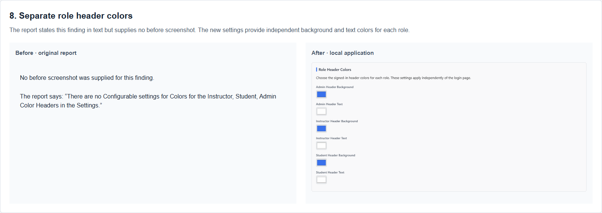

## 9. Past schedules are distinct

After: Show Past Schedules and Collapse All are enabled. Past groups carry a label and a different header color.

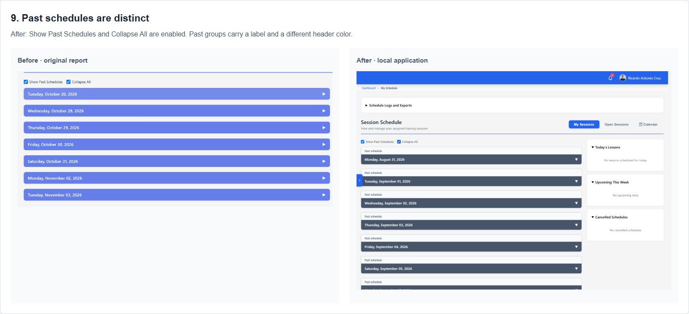

## 10. Student training PDF export

After: Export PDF is visible in the training hub. Both the individual record and training-list PDF endpoints were verified.

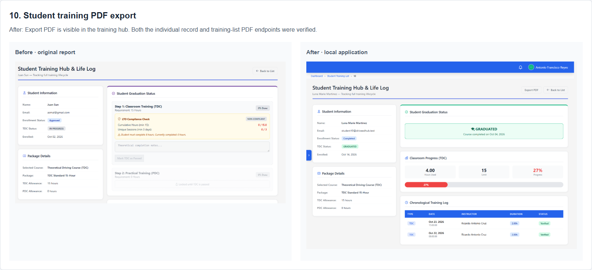

## 11. Enrollment verification layout

After: desktop and mobile. The local student’s missing placeholder license file is explicitly identified as unavailable.

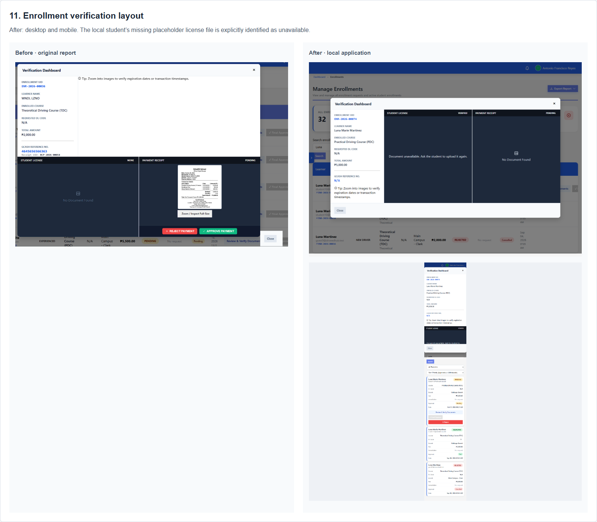

## 12. Enrollment search

After: searching for Luna filters the list while retaining status, branch, and sort controls.

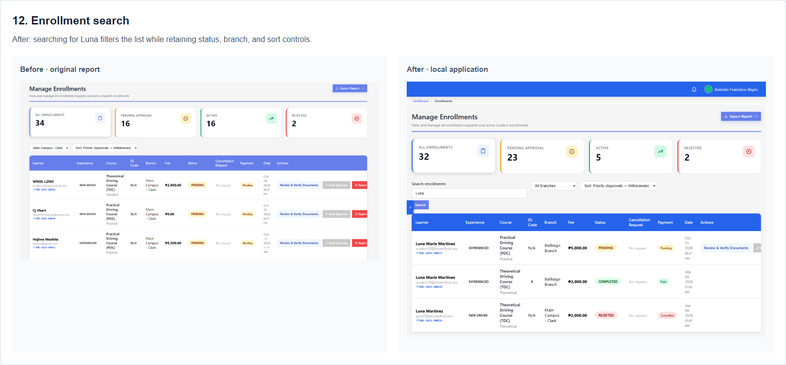

## 13. Dashboard cards open filtered user lists

After: dashboard and the student roster reached by clicking Total Students. Other card destinations were also verified.

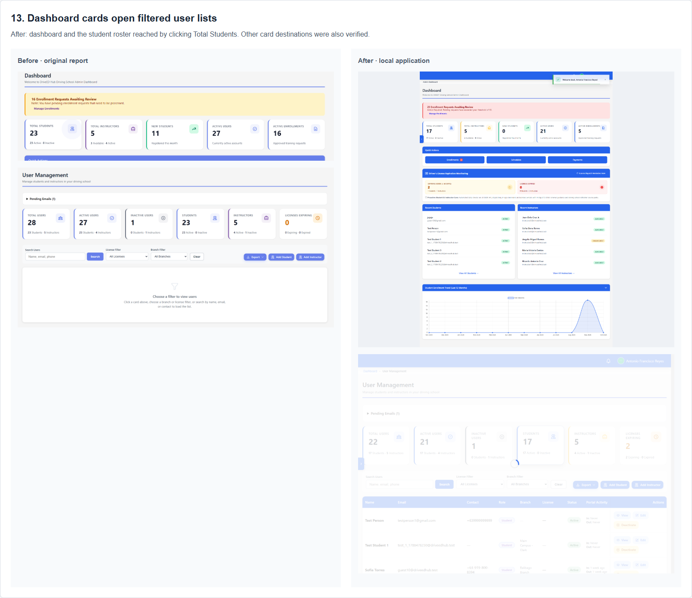

## 14. Prevent sessions beyond required hours

After: a temporary full-hours test fixture shows the explanation and disabled button. A tampered request was rejected with HTTP 422. Test sessions were removed.

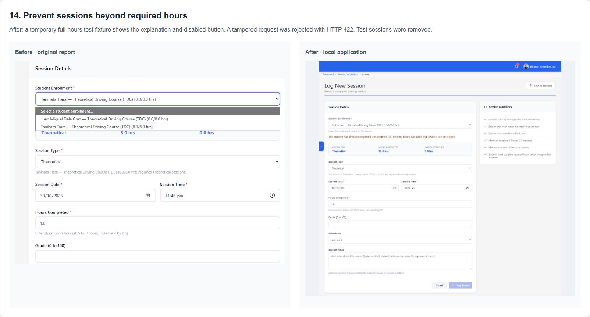
